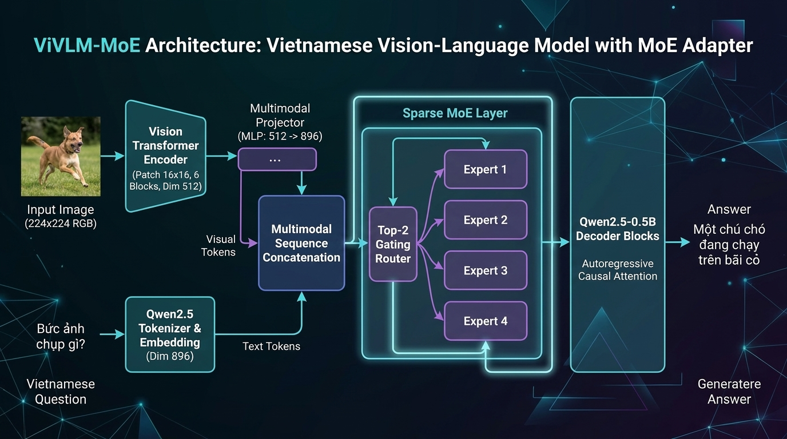

# 🇻🇳 ViVLM-MoE: Vietnamese Vision-Language Model with Multimodal Mixture-of-Experts

[](https://www.python.org/)
[](https://pytorch.org/)
[](LICENSE)
[](https://wandb.ai/)

An end-to-end, lightweight **Vietnamese Vision-Language Model (VLM)** built from scratch in PyTorch, integrating a **Sparse Multimodal Mixture-of-Experts (MoE)** adapter placed directly after sequence fusion and preceding a frozen language model decoder.

---

## 🏛️ Model Architecture



ViVLM-MoE employs a modular, parameter-efficient multimodal architecture tailored for fast training and low-latency inference on consumer GPUs ($\le 12$GB VRAM):

1. **Dual Vision Tower Support (Custom ViT or Pretrained SigLIP/CLIP):**
   - **Option 1 (Custom ViT from Scratch):** 2D Convolutional Patch Projection ($P = 16 \times 16$, stride 16), 1D Learnable Positional Embeddings, and 6 Pre-Norm Transformer Encoder Blocks ($d_{\text{vision}} = 512$, 8 heads).
   - **Option 2 (Pretrained Vision Backbone - Recommended):** Integrates Google's `google/siglip-base-patch16-224` (87M parameters, $d_{\text{vision}} = 768$, 196 patch tokens) or `openai/clip-vit-base-patch16` with frozen weights, providing rich visual representations for superior VQA quality with only ~1.38M trainable projector parameters in Stage 1.

2. **Multimodal Projector:**
   - 2-layer Feed-Forward Network with GELU non-linearity.
   - Automatically adapts input dimension from $d_{\text{vision}}$ (512 or 768) into the language model hidden dimension ($d_{\text{llm}} = 896$).

3. **Multimodal Sequence Fusion:**
   - Concatenates projected visual prefix tokens and tokenized Vietnamese question tokens:
     $$\mathbf{H}_{\text{fused}} = [\mathbf{H}_{\text{vision}} \,\|\, \mathbf{H}_{\text{text}}] \in \mathbb{R}^{B \times (196 + N_t) \times 896}$$

4. **Sparse Multimodal MoE Adapter:**
   - Active during Stage 2 training and inference.
   - **Router / Gating Network:** Linear projection ($896 \to 4$) followed by Top-$k$ ($k=2$) Softmax gating.
   - **Expert Networks:** 4 independent MLP experts specializing in diverse multimodal features.
   - **Auxiliary Load Balancing Loss:** Switch Transformer auxiliary loss formulation ($\alpha = 0.01$) to prevent router collapse and ensure uniform expert utilization.
   - **Residual Skip Connection:** Preserves original sequence representations alongside expert activations.

5. **Pretrained Language Decoder:**
   - Powered by `Qwen/Qwen2.5-0.5B-Instruct` with frozen weights.
   - Retains fluent Vietnamese syntactic and semantic generative capabilities with zero catastrophic forgetting.

---

## 📌 Key Highlights

- **From-Scratch Multimodal Pipeline:** Pure PyTorch implementation of Multi-Head Self-Attention, Pre-Norm Encoder Blocks, ViT, Projector, and MoE routing.
- **Ultra-Lightweight & Consumer-GPU Friendly:** Total model parameters: **~536M**, with only **~20.7M trainable parameters** in Stage 1 and **~25.7M trainable parameters** in Stage 2.
- **Low Memory Footprint:** Requires only **~4.2 GB – 5.0 GB VRAM** during FP16 training with gradient accumulation, running smoothly on RTX 3060, RTX 4060, and RTX 5060 Ti GPUs.
- **Automated Early Stopping:** Tracks validation loss after every epoch and automatically halts training when loss plateaus, preventing overfitting.
- **Streamlined Checkpointing:** Automatically saves only the **`best`** checkpoint (lowest validation loss) and the **`last`** checkpoint, keeping storage clean and lightweight.
- **Comprehensive Evaluation Suite:** Benchmark script computing 5 standard metrics: **BLEU-4**, **ROUGE-L**, **METEOR**, **CIDEr**, and **BERTScore**.
- **Interactive Gradio Web UI:** User-friendly web interface supporting real-time image upload, Vietnamese visual question answering, and a live toggle for the MoE adapter.

---

## 📂 Project Directory Structure

```
VLM_from_scratch/
├── .env                          # Weights & Biases API key (gitignored)
├── .gitignore                    # Git exclusion rules
├── README.md                     # Project documentation
├── requirements.txt              # Python dependencies
├── main.py                       # Interactive Gradio Web UI
│
├── assets/
│   └── vivlm_moe_architecture.png # Generated high-resolution architecture diagram
│
├── configs/
│   └── default.yaml              # Centralized configuration (model, MoE, data, training)
│
├── scripts/
│   ├── download_images.py        # High-speed multi-threaded MS COCO image downloader
│   ├── train.py                  # Multi-stage training CLI script
│   └── evaluate.py               # 5-metric evaluation CLI script
│
├── src/
│   ├── __init__.py
│   ├── model/                    # Model architecture modules
│   │   ├── __init__.py
│   │   ├── attention.py          # Scaled Dot-Product Multi-Head Attention
│   │   ├── mlp.py                # 2-Layer Feed-Forward Network
│   │   ├── encoder_block.py      # Pre-Norm Transformer Encoder Block
│   │   ├── vision_encoder.py     # Custom Vision Transformer (ViT)
│   │   ├── projector.py          # 2-Layer Multimodal Projector (512 -> 896)
│   │   ├── moe.py                # Multimodal MoE Layer (Router + 4 Experts + Aux Loss)
│   │   └── vlm.py                # End-to-End ViVLM-MoE Model
│   ├── data/
│   │   ├── __init__.py
│   │   └── dataset.py            # ViVQA Dataset Loader & Dynamic Collator with Loss Masking
│   ├── training/
│   │   ├── __init__.py
│   │   ├── trainer.py            # VLMTrainer with Early Stopping, FP16 AMP & WandB
│   │   └── evaluator.py          # Evaluator for BLEU-4, ROUGE-L, METEOR, CIDEr, BERTScore
│   └── utils/
│       ├── __init__.py
│       └── config.py             # Config loader, GPU diagnostics & seed utilities
│
├── data/                         # Local dataset directory (gitignored)
├── hf_cache/                     # Local Hugging Face cache (gitignored)
├── checkpoints/                  # Trained model checkpoints (gitignored)
└── outputs/                      # Evaluation outputs (gitignored)
```

---

## ⚙️ Installation

The project uses the fast Python package manager **`uv`** with a standalone `.venv` virtual environment:

```powershell
# 1. Activate the virtual environment
.\.venv\Scripts\activate

# 2. Install required packages
uv pip install -r requirements.txt
```

---

## 🚀 Quickstart & Usage

All hyperparameters, dataset paths, and training stages are configured centrally in [`configs/default.yaml`](configs/default.yaml). You can run all tasks using minimal commands without passing verbose arguments.

> **Note:** All CLI arguments (`--epochs`, `--batch-size`, `--lr`, `--checkpoint`, `--max-samples`, etc.) remain fully supported if you wish to override settings on the command line.

### 1. Download Dataset Images (Optional)
The Vietnamese VQA dataset (`ThucPD/ViVQA`) references MS COCO images. Download images locally using multi-threaded acceleration:

```powershell
python scripts/download_images.py
```
*(If images are not downloaded, the data loader automatically synthesizes neutral fallback images so training and testing run without interruption).*

---

### 2. Stage 1: Train Base ViVLM (Dense Mode)
Trains the Vision Transformer and Multimodal Projector to align visual representations with the language model space:

```powershell
python scripts/train.py
```
- Monitors validation loss each epoch.
- Automatically stops early if validation loss plateaus.
- Saves the best checkpoint to `checkpoints/stage1_best.pt` and latest state to `checkpoints/stage1_last.pt`.

---

### 3. Stage 2: Train Multimodal MoE Adapter (MoE Mode)
Activates the `MultimodalMoELayer`, auto-loads the best Stage 1 weights, freezes the base model, and trains the router and expert networks:

```powershell
python scripts/train.py --stage 2
```
- Automatically routes visual and language tokens across 4 specialized MLP experts (Top-2 active).
- Optimizes task cross-entropy loss along with the auxiliary load-balancing loss.
- Saves best weights to `checkpoints/stage2_best.pt` and latest state to `checkpoints/stage2_last.pt`.

---

### 4. Evaluate Model Performance
Evaluate predictions on the test dataset across 5 standard metrics:

```powershell
python scripts/evaluate.py
```
*(Automatically discovers and loads the best available checkpoint from `checkpoints/`, or specify `--checkpoint checkpoints/stage2_best.pt`).*

**Example Output:**
```
==================================================
           EVALUATION RESULTS SUMMARY
==================================================
  BLEU-4              : 32.45
  ROUGE-L             : 48.12
  METEOR              : 35.60
  CIDEr               : 62.30
  BERTScore-F1        : 74.85
  samples_evaluated   : 100
==================================================
```

---

### 5. Interactive Web Demo (Gradio UI)
Launch the browser application to test visual question answering with your trained model:

```powershell
python main.py
```
- Open your browser at `http://localhost:7860`.
- Upload any image and ask questions in Vietnamese.
- Toggle the Multimodal MoE Adapter on/off in real-time to observe routing behavior.

---

## 📊 Parameter Count & Memory Profile

| Component | Parameter Count | Stage 1 Status | Stage 2 Status |
| :--- | :--- | :--- | :--- |
| **Vision Encoder** *(From scratch)* | 19.4 M | **Trainable** | Frozen |
| **Multimodal Projector** *(From scratch)* | 1.3 M | **Trainable** | Frozen |
| **Multimodal MoE Adapter** *(From scratch)* | 25.7 M | Disabled | **Trainable** |
| **Pretrained LLM Decoder** | 490.0 M | **Frozen** | **Frozen** |
| **Total Model** | **~536.4 M (~0.53B)** | **20.7 M trainable** | **25.7 M trainable** |

- **Training VRAM Footprint:** ~4.2 GB – 5.0 GB (Mixed Precision FP16, batch size 8).
- **Target Hardware:** Compatible with any modern GPU with $\ge 6$GB VRAM.

---

## 🛠️ Configuration Guide

Key options in [`configs/default.yaml`](configs/default.yaml):

```yaml
model:
  vision_encoder_type: "pretrained"   # "pretrained" (Option 2: SigLIP/CLIP) or "scratch" (Option 1: Custom ViT)
  pretrained_vision_name: "google/siglip-base-patch16-224"  # HuggingFace vision backbone
  freeze_vision_encoder: true         # Freeze pretrained weights during training
  d_vision: 512                 # Custom ViT dimension (auto-detected if pretrained)
  patch_size: 16                # Patch size (16x16)
  image_size: 224               # Input resolution
  llm_name: "Qwen/Qwen2.5-0.5B-Instruct"

moe:
  enabled: false                # Enabled automatically for Stage 2
  num_experts: 4                # Number of expert MLPs
  top_k: 2                      # Active experts per token
  aux_loss_weight: 0.01         # Load balancing loss coefficient

training:
  stage: 1                      # Default training stage (1 or 2)
  batch_size: 8
  learning_rate: 1.0e-4         # Learning rate (1e-4)
  num_epochs: 5
  fp16: true
  early_stopping:
    enabled: true               # Halt training on loss plateau
    patience: 3                 # Epoch patience
    min_delta: 0.001
    monitor: "val_loss"
```

---

## 📜 License & Citation

Distributed under the **MIT License**. The Vision Transformer, Multimodal Projector, and MoE routing architectures are implemented from scratch for educational and research purposes.
