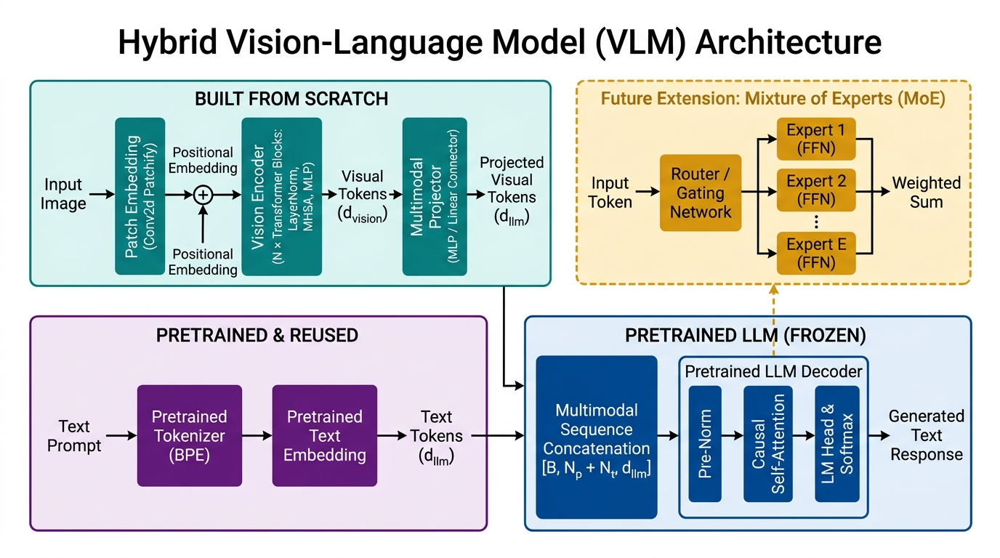

# Kiến Trúc Hybrid VLM (From-Scratch Vision & Projector + Pretrained LLM) & Lộ Trình MoE

Tài liệu này hệ thống hóa thiết kế kiến trúc của một **Vision-Language Model (VLM) dạng lai (Hybrid Architecture)** — mô hình chuẩn mực được áp dụng rộng rãi trong các hệ thống hiện đại như **LLaVA, MiniGPT-4, Qwen-VL**. 

Trong thiết kế này:
- **Tự xây dựng từ đầu (From Scratch):** Toàn bộ nhánh Vision Tower (Vision Transformer) và cầu nối đa phương thức (Multimodal Projector) để bạn rèn luyện sâu bản chất thị giác máy tính và biểu diễn đa phương thức.
- **Kế thừa & tái sử dụng (Pretrained & Reused):** Tận dụng Tokenizer và mô hình ngôn ngữ lớn có sẵn (như Qwen hoặc Llama) đóng băng trọng số để đảm bảo văn bản sinh ra tự nhiên, chuẩn ngữ pháp và tiết kiệm tối đa tài nguyên huấn luyện.
- **Lộ trình nâng cấp tương lai:** Tích hợp kiến trúc chuyên gia thưa **Mixture of Experts (MoE)**.

---

## 1. Sơ Đồ Kiến Trúc Tổng Quát

### Phân Định Rõ Vai Trò Trong Kiến Trúc Mới:
1. **Vision Pathway (Tự xây dựng từ đầu - From Scratch):**
   - Đầu vào: Ảnh kích thước $(B, C, H, W)$.
   - Qua bước cắt mảnh (Patch Embedding) và cộng vector vị trí không gian (Positional Embedding).
   - Chuỗi patch tokens đi qua chuỗi các khối Transformer Encoder xếp chồng (Pre-Norm, Self-Attention hai chiều, MLP, Residuals).
   - Xuất ra chuỗi đặc trưng thị giác dạng vector có chiều ẩn $d_{\text{vision}}$.

2. **Multimodal Projector (Tự xây dựng từ đầu - From Scratch):**
   - Đóng vai trò cầu nối không gian vector: ánh xạ từ $d_{\text{vision}} \to d_{\text{llm}}$ (trong đó $d_{\text{llm}}$ là chiều ẩn của mô hình ngôn ngữ mục tiêu).
   - Cấu trúc thông dụng: Khối MLP 2 tầng xen kẽ hàm kích hoạt phi tuyến (GELU/SiLU).

3. **Text Pathway (Kế thừa từ Pretrained LLM):**
   - Sử dụng trực tiếp **Tokenizer** đi kèm với Pretrained LLM (ví dụ: Qwen Tokenizer hoặc Llama Tokenizer) để biến câu truy vấn thành các token ID nguyên.
   - Đưa qua bảng nhúng từ (**Pretrained Text Embedding**) của LLM để thu được chuỗi vector văn bản trong không gian $d_{\text{llm}}$.

4. **Hợp Nhất Đa Phương Thức & Pretrained LLM Decoder (Kế thừa & Đóng băng):**
   - Ghép nối chuỗi Visual Tokens (sau Projector) và chuỗi Text Tokens thành một chuỗi tensor hợp nhất có kích thước $(B, N_p + N_t, d_{\text{llm}})$.
   - Truyền chuỗi này vào các khối Decoder của Pretrained LLM thông qua cổng nhận vector nhúng (`inputs_embeds`).
   - LLM Decoder tính toán Causal Masked Self-Attention và qua LM Head để sinh văn bản tự hồi quy.

---

## 2. Vì Sao Không Cần Tự Xây Dựng Text Encoder & Tokenizer BPE Từ Đầu?

Một trong những băn khoăn phổ biến khi bắt đầu xây dựng VLM là: *"Liệu có cần tự làm Text Encoder và tự huấn luyện thuật toán tách từ BPE hay không?"*

Câu trả lời là **KHÔNG CẦN THIẾT**, xuất phát từ hai lý do kỹ thuật quan trọng:

1. **Khác biệt giữa VLM Tạo Sinh (Generative VLM) và VLM Đối Chiếu (Dual-Encoder / CLIP):**
   - Trong mô hình phân loại/đối chiếu như CLIP, ta cần 2 nhánh độc lập: 1 Image Encoder và 1 Text Encoder riêng để chiếu cả hai về cùng một không gian đo độ tương đồng (cosine similarity).
   - Trong VLM tạo sinh (sinh văn bản theo câu hỏi và hình ảnh), **không có nhánh Text Encoder riêng**. Toàn bộ nhiệm vụ hiểu văn bản và sinh văn bản được đảm nhận bởi **LLM Decoder**.
2. **Giá trị của việc kế thừa Pretrained LLM:**
   - Để một mô hình ngôn ngữ tự viết từ đầu có thể sinh ra câu cú ngữ pháp mạch lạc, bạn cần hàng tỷ tới hàng nghìn tỷ token văn bản cùng cụm máy chủ GPU khổng lồ để pretrain nhiều tuần/tháng. Nếu tự train một LLM nhỏ trên máy cá nhân, văn bản sinh ra thường là từ ngữ vô nghĩa hoặc lặp lại.
   - Mỗi Pretrained LLM (như `Qwen2.5-0.5B` hay `Llama-3.2-1B`) **đã có sẵn Tokenizer được tối ưu hóa từ điển BPE hoàn chỉnh** và **đã chứa sẵn tri thức ngôn ngữ phong phú**.
   - Việc mượn Tokenizer và đóng băng LLM Decoder giúp bạn:
     - Tập trung 100% thời gian vào việc học và tự code kiến trúc thị giác (ViT) và cầu nối đa phương thức (Projector).
     - Huấn luyện được mô hình VLM hoàn chỉnh ngay trên một GPU cá nhân hoặc Colab với tập dữ liệu nhỏ (vài nghìn đến vài chục nghìn mẫu).

---

## 3. Luồng Biến Đổi Dữ Liệu Chi Tiết (Tensor Shapes & Data Flow)

Giả sử chọn ảnh đầu vào $224 \times 224$ ($C=3, H=224, W=224$), kích thước patch $P=16$, chiều thị giác $d_{\text{vision}} = 512$, và chọn Pretrained LLM là `Qwen2.5-0.5B` ($d_{\text{llm}} = 896$):

1. **Nhánh Thị Giác (From-Scratch):**
   - Số patch ảnh sinh ra: $N_p = \frac{224}{16} \times \frac{224}{16} = 14 \times 14 = 196$.
   - Ảnh $(B, 3, 224, 224)$ qua Patch Embedding thành tensor $(B, 196, 512)$.
   - Cộng Positional Embedding kích thước $(1, 196, 512)$ để bảo toàn tọa độ không gian 2D.
   - Đi qua $N_{\text{vis}}$ khối Transformer Encoder Block (Pre-Norm, Self-Attention không che mặt nạ, MLP), đầu ra vẫn giữ kích thước $(B, 196, 512)$.

2. **Cầu Nối Đa Phương Thức (From-Scratch Projector):**
   - Đưa chuỗi $(B, 196, 512)$ qua Projector (chiếu tuyến tính hoặc MLP 2 tầng), đầu ra chuyển sang kích thước $(B, 196, 896)$. Lúc này các vector ảnh đã nằm trên cùng không gian chiều ẩn của Qwen.

3. **Nhánh Văn Bản (Pretrained Tokenizer + Embedding):**
   - Đoạn prompt (ví dụ: `<image>\nMô tả bức ảnh sau:` dài $N_t$ tokens) được Tokenizer chuyển thành mảng chỉ số nguyên $(B, N_t)$.
   - Đi qua tầng nhúng từ có sẵn của LLM thành tensor $(B, N_t, 896)$.

4. **Hợp Nhất Chuỗi Đa Phương Thức (Multimodal Fusion):**
   - Chuỗi đặc trưng ảnh $(B, N_p, 896)$ và chuỗi đặc trưng từ $(B, N_t, 896)$ được ghép nối thành một chuỗi thống nhất:
     $$(B, N_p + N_t, 896) = (B, 196 + N_t, 896)$$
   - *(Hoặc thay thế trực tiếp vector của token placeholder `<image>` trong prompt bằng toàn bộ 196 vector của ảnh).*

5. **Giải Mã & Sinh Tự Hồi Quy (Pretrained LLM Decoder):**
   - Toàn bộ tensor $(B, 196 + N_t, 896)$ được đưa vào LLM qua cổng nhận vector nhúng (`inputs_embeds`).
   - LLM áp dụng Causal Self-Attention (mặt nạ tam giác dưới để bảo toàn nguyên lý nhân quả) và qua LM Head để tính phân phối xác suất từ kế tiếp trên từ điển kích thước $V$.

---

## 4. Phân Tích Kỹ Thuật Từng Khối Thành Phần

### 4.1. Vision Tower (Tự Xây Dựng)
- **Patch Embedding:** Tận dụng phép tích chập 2D với kernel và stride bằng kích thước patch ($P=16$) để ánh xạ từng vùng điểm ảnh thành 1 vector biểu diễn.
- **Positional Embedding:** Bắt buộc phải có vì Self-Attention là phép toán bất biến hoán vị. Có thể chọn:
  - *1D Learnable Positional Embedding:* Một ma trận tham số có thể học được kích thước $(1, N_p, d_{\text{vision}})$.
  - *2D Sinusoidal Positional Embedding:* Các hàm lượng giác sin/cos cố định theo tọa độ lưới hàng và cột.
- **Transformer Encoder Blocks:** Xếp chồng $N_{\text{vis}}$ khối Transformer (Pre-Norm, Multi-Head Self-Attention không che mặt nạ, MLP mở rộng 4 lần chiều ẩn, Residual Connections).
- **Lưu ý kiến trúc quan trọng:** Lớp cắt patch (Patch Embedding) chỉ chạy **duy nhất 1 lần** ở đầu vào; các khối Encoder Block chỉ nhận và trả về chuỗi vector để có thể xếp chồng nhiều tầng một cách độc lập.

### 4.2. Multimodal Projector (Tự Xây Dựng)
- **Cấu trúc khuyên dùng:** Khối MLP 2 tầng gồm:
  $$\text{Linear}(d_{\text{vision}}, d_{\text{llm}}) \to \text{GELU} \to \text{Linear}(d_{\text{llm}}, d_{\text{llm}})$$
- **Vai trò:** Căn chỉnh phân phối đặc trưng hình ảnh (vốn có tính liên tục cao) khớp với không gian ngữ nghĩa rời rạc của mô hình ngôn ngữ.

### 4.3. Pretrained LLM Decoder (Kế Thừa & Đóng Băng)
Gợi ý các mô hình ngôn ngữ nhỏ gọn (SLM) lý tưởng cho việc luyện tập cá nhân:
- **`Qwen/Qwen2.5-0.5B`** (Lựa chọn hàng đầu): Rất nhẹ, hỗ trợ tiếng Việt và tiếng Anh xuất sắc, chiều ẩn $d_{\text{llm}} = 896$.
- **`HuggingFaceTB/SmolLM2-135M`**: Siêu nhẹ (~135M tham số), huấn luyện và chạy thử cực nhanh, phù hợp để kiểm tra luồng tensor.
- **`meta-llama/Llama-3.2-1B`**: 1 tỷ tham số, năng lực tư duy ngôn ngữ rất tốt nếu bạn có card đồ họa tương đối khỏe.

---

## 5. Cơ Chế Huấn Luyện & Loss Masking

### 5.1. Loss Masking (Mặt Nạ Bỏ Qua Khi Tính Hàm Mất Mát)
Trong quá trình huấn luyện bằng hàm mất mát Cross-Entropy (Next-Token Prediction):
- Ta **không** tính loss trên các vị trí thuộc **Visual Tokens** (vì ảnh là tín hiệu liên tục, không phải nhãn từ vựng).
- Ta **không** tính loss trên các vị trí thuộc **Prompt câu hỏi** của người dùng (mô hình không cần học thuộc câu hỏi).
- Ta **không** tính loss trên các vị trí **Padding**.
- Gradient **chỉ được tính** trên phần câu trả lời mục tiêu (Target Answer). Các vị trí khác được gán nhãn bỏ qua (ignore index, thường là `-100`).

### 5.2. Chiến Lược Huấn Luyện Tối Ưu (2 Giai Đoạn)
- **Giai đoạn 1 — Feature Alignment (Căn chỉnh đặc trưng):**
  - Đóng băng hoàn toàn Pretrained LLM và Vision Tower.
  - **Chỉ huấn luyện duy nhất Multimodal Projector** trên tập dữ liệu mô tả ảnh (Image Captioning).
  - Vì số lượng tham số của Projector rất nhỏ, giai đoạn này diễn ra cực kỳ nhanh và nhẹ về bộ nhớ VRAM.
- **Giai đoạn 2 — Visual Instruction Tuning (Tinh chỉnh theo chỉ dẫn):**
  - Mở khóa thêm Vision Tower (hoặc áp dụng LoRA lên LLM) để huấn luyện trên tập dữ liệu hỏi đáp đa phương thức (VQA).

---

## 6. Lộ Trình Mở Rộng Tương Lai: Tích Hợp Mixture of Experts (MoE)

Khi hệ thống VLM lai cơ bản đã chạy hoàn chỉnh từ đầu đến cuối, bạn có thể tích hợp **Sparse Mixture of Experts (MoE)** theo 2 hướng tiếp cận:

### Hướng 1: Tự Xây Dựng Tầng MoE Trong Vision Encoder (Vision-MoE)
- Thay thế khối Dense MLP bên trong các khối `EncoderBlock` bằng một tầng **Sparse MoE Layer**.
- **Cấu trúc tầng MoE:**
  1. *Router / Gating Network:* Nhận vector đặc trưng của từng patch ảnh, chấm điểm phân phối qua Softmax tới $E$ chuyên gia (ví dụ $E=8$).
  2. *Top-K Selection:* Chỉ chọn lọc $K$ chuyên gia có điểm cao nhất ($K=1$ hoặc $K=2$) cho mỗi patch ảnh.
  3. *Experts Pool:* Tập hợp $E$ khối MLP độc lập hoạt động song song.
  4. *Weighted Sum Aggregation:* Tổng hợp đầu ra có trọng số từ $K$ chuyên gia được chọn.
  5. *Auxiliary Load Balancing Loss:* Thêm hàm phạt vào loss tổng để tránh hiện tượng mọi patch ảnh bị dồn về 1 chuyên gia (Router Collapse).

### Hướng 2: Nâng Cấp Bộ Giải Mã Sang Pretrained MoE LLM
- Thay vì sử dụng Pretrained LLM Dense (như Qwen2.5-0.5B), bạn có thể nâng cấp phần Decoder sang một mô hình Pretrained MoE có sẵn (ví dụ: `Qwen1.5-MoE-A2.7B` hoặc các biến thể DeepSeekMoE nhỏ gọn).
- Toàn bộ luồng Vision Tower và Projector bạn tự viết từ đầu vẫn được giữ nguyên và kết nối tương thích.
